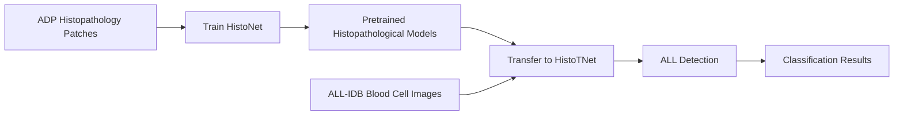

<div align="center">

# 🧬 HistoTNet

### Histopathological Transfer Learning for Acute Lymphoblastic Leukemia Detection

[](https://www.python.org/)
[](https://pytorch.org/)
[](LICENSE)
[](https://ieeexplore.ieee.org/document/9493677)
[](https://iebil.di.unimi.it/cnnALL/index.htm)

**Source code for the IEEE CIVEMSA 2021 paper**  
*Histopathological transfer learning for Acute Lymphoblastic Leukemia detection*

</div>

---

## 🧠 Overview

**HistoTNet** is a PyTorch implementation of a transfer-learning framework for **Acute Lymphoblastic Leukemia (ALL) detection** from microscopic blood-cell images.

The repository contains two related training pipelines:

1. **HistoNet** — a histopathology network trained on the **Atlas of Digital Pathology (ADP)** dataset.
2. **HistoTNet** — a transfer-learning network that uses the learned histopathological representation for ALL detection on the **ALL-IDB** dataset.

The method explores how knowledge learned from large-scale histopathological tissue images can support leukemia image classification in a smaller biomedical dataset.

---

## 🔬 Method at a Glance

<div align="center">



</div>

### Core idea

```text
Large histopathology dataset
        │
        ▼
HistoNet representation learning
        │
        ▼
Transferred model initialization
        │
        ▼
HistoTNet fine-tuning on ALL-IDB
        │
        ▼
Acute Lymphoblastic Leukemia classification
```

---

## 📁 Repository Structure

```text
HistoTNet/
│
├── (1) PyTorch_HistoNet/
│   ├── pytorch_histonet.py          # Train/test HistoNet on ADP
│   ├── classes/                     # Dataset and model classes
│   ├── functions/                   # Training/evaluation utilities
│   ├── modelGeno/                   # Model definitions
│   ├── params/                      # HistoNet configuration files
│   ├── util/                        # Helper functions
│   └── db_orig/ADP/                 # Expected ADP dataset location
│
├── (2) PyTorch_HistoTNet/
│   ├── pytorch_histotnet.py         # Train/test HistoTNet on ALL-IDB
│   ├── pretrained_nets/             # Pretrained HistoNet models
│   └── db/ALL_IDB2/                 # Expected ALL-IDB dataset location
│
├── packages.txt                     # Python package requirements
├── LICENSE                          # GPL-3.0 license
└── README.md
```

---

## 🚀 Getting Started

### 1. Clone the repository

```bash
git clone https://github.com/AngeloUNIMI/HistoTNet.git
cd HistoTNet
```

### 2. Install dependencies

Install the Python packages listed in:

```text
packages.txt
```

For example:

```bash
pip install -r packages.txt
```

A virtual environment is recommended:

```bash
python -m venv .venv
.venv\Scripts\activate   # Windows
# source .venv/bin/activate   # Linux/macOS
pip install -r packages.txt
```

---

## 🧪 Datasets

This project uses two biomedical image datasets.

### 1. Atlas of Digital Pathology (ADP)

Used to train **HistoNet**.

Expected location:

```text
(1) PyTorch_HistoNet/db_orig/ADP/
```

Required files include:

```text
(1) PyTorch_HistoNet/db_orig/ADP/img_res_1um_bicubic/
(1) PyTorch_HistoNet/db_orig/ADP/ADP_EncodedLabels_Release1_Flat.csv
```

Example image path:

```text
(1) PyTorch_HistoNet/db_orig/ADP/img_res_1um_bicubic/001.png_crop_16.png
```

Dataset page:

```text
https://www.dsp.utoronto.ca/projects/ADP/
```

### 2. ALL-IDB

Used to train and test **HistoTNet** for Acute Lymphoblastic Leukemia detection.

Expected location:

```text
(2) PyTorch_HistoTNet/db/ALL_IDB2/
```

Example image path:

```text
(2) PyTorch_HistoTNet/db/ALL_IDB2/Im001_1.tif
```

Dataset page:

```text
https://homes.di.unimi.it/scotti/all/
```

---

## ⚙️ Usage

### Step 1 — Train HistoNet on ADP

Move into the HistoNet folder:

```bash
cd "(1) PyTorch_HistoNet"
```

Run:

```bash
python pytorch_histonet.py
```

This trains/tests the HistoNet model on ADP histopathology patches.

---

### Step 2 — Transfer pretrained models

Copy the trained HistoNet models into:

```text
(2) PyTorch_HistoTNet/pretrained_nets/
```

Some pretrained models may already be included for convenience.

---

### Step 3 — Train HistoTNet on ALL-IDB

Move into the HistoTNet folder:

```bash
cd "../(2) PyTorch_HistoTNet"
```

Run:

```bash
python pytorch_histotnet.py
```

This trains/tests the transfer-learning network for ALL detection.

---

## 📊 Outputs

Depending on the selected parameter configuration, the scripts generate training and testing outputs such as:

| Output type | Description |
|---|---|
| Training logs | Epoch-wise learning information |
| Model files | Trained network weights |
| Classification results | ALL detection performance |
| Evaluation summaries | Metrics and experiment outputs |

---

## 📚 Related Datasets and References

### Atlas of Digital Pathology

Mahdi S. Hosseini, Lyndon Chan, Gabriel Tse, Michael Tang, Jun Deng, Sajad Norouzi, Corwyn Rowsell, Konstantinos N. Plataniotis, and Savvas Damaskinos,  
**“Atlas of Digital Pathology: A Generalized Hierarchical Histological Tissue Type-Annotated Database for Deep Learning,”**  
*Proceedings of the IEEE/CVF Conference on Computer Vision and Pattern Recognition (CVPR)*, 2019, pp. 11747–11756.

### ALL-IDB

R. Donida Labati, V. Piuri, and F. Scotti,  
**“ALL-IDB: The Acute Lymphoblastic Leukemia Image Database for Image Processing,”**  
*Proc. of the 2011 IEEE International Conference on Image Processing (ICIP 2011)*, Brussels, Belgium, pp. 2045–2048, September 11–14, 2011.  
DOI: `10.1109/ICIP.2011.6115881`

---

## 📖 Paper

If you use this repository, please cite:

```bibtex
@InProceedings{civemsa21all,
  author    = {A. Genovese and M. S. Hosseini and V. Piuri and K. N. Plataniotis and F. Scotti},
  title     = {Histopathological transfer learning for Acute Lymphoblastic Leukemia detection},
  booktitle = {Proc. of the 2021 IEEE Int. Conf. on Computational Intelligence and Virtual Environments for Measurement Systems and Applications (CIVEMSA 2021)},
  month     = {June},
  day       = {18--20},
  year      = {2021},
  pages     = {1--6},
  isbn      = {978-1-6654-1249-0},
  doi       = {10.1109/CIVEMSA52099.2021.9493677}
}
```

Paper:

```text
https://ieeexplore.ieee.org/document/9493677
```

Project page:

```text
https://iebil.di.unimi.it/cnnALL/index.htm
```

---

## 👥 Authors

**Angelo Genovese**, **Vincenzo Piuri**, and **Fabio Scotti**  
Department of Computer Science  
Università degli Studi di Milano, Italy

**Mahdi S. Hosseini** and **Konstantinos N. Plataniotis**  
Department of Electrical and Computer Engineering  
University of Toronto, Canada

---

## 📄 License

This project is released under the **GNU General Public License v3.0**.

See the [LICENSE](LICENSE) file for details.
